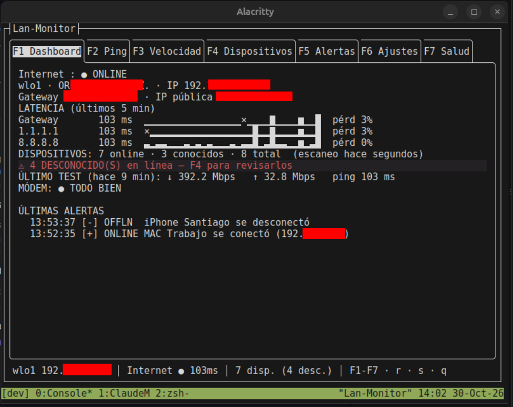

# Lan-Monitor

Monitor de red para terminal (TUI, .NET 10 + Terminal.Gui v2). Corre **sin sudo**.

Ve qué dispositivos hay en tu red (y avisa de los desconocidos), mide ping, jitter, pérdida y velocidad, y te dice
cuándo conviene reiniciar el módem.

## Requisitos
- Linux (x64, arm64 o arm — sirve en una Raspberry Pi como monitor siempre encendido).
- SDK de .NET 10, solo para compilar/instalar.
- Opcional: `notify-send` (notificaciones de escritorio) y `nmcli` (mostrar el SSID).

| Tecla | Acción |
|---|---|
| F1–F7 | Dashboard · Ping · Velocidad · Dispositivos · Alertas · Ajustes · Salud del módem |
| r | Escanear la red ahora |
| s | Test de velocidad (Cloudflare) |
| q | Salir |
| Dispositivos: k / n / Enter / `/` / o / Supr | conocido · apodo · detalle (notas, puertos, Wake-on-LAN) · filtrar · solo online · olvidar |
| Ping: w · Alertas: f | cambiar ventana · cambiar filtro |
| Ajustes: Enter / e | editar · exportar CSV a `~/lan-monitor-export/` |

Datos: `~/.local/share/lan-monitor/lanmonitor.db` · Config: `~/.config/lan-monitor/config.json`

## Salud del módem (F7)
Evalúa cada 30 s si conviene reiniciar el módem y avisa (alerta + notificación, máx. 1 vez cada 2 h). Señales:
corte con el router vivo >2 min · 3+ cortes en 3 h · pérdida/jitter sostenidos hacia internet · latencia ≥2–3× su
normal de 24 h · tests de velocidad a menos de la mitad de lo habitual. Si la inestabilidad ya está entre tu equipo y
el router, lo atribuye al WiFi y **no** recomienda reiniciar el módem.

## MAC privadas
Celulares y laptops modernos rotan su MAC por red (⚑). Si reaparece con otra MAC privada y el mismo hostname, se
trata como el mismo dispositivo (conserva apodo e historial). Los desconocidos con MAC privada inactivos más allá de
la retención se limpian solos.

## Ejecutar
    dotnet run --project src/LanMonitor.App

## Instalar como comando
    git clone https://github.com/santidev21/Lan-Monitor.git && cd Lan-Monitor
    ./install.sh              # comando: lan-monitor
    ./install.sh monitor-lan  # o el nombre que prefieras
    ./install.sh --uninstall

Detecta la arquitectura, compila un binario autocontenido en `~/.local/lib/lan-monitor` y crea el comando en
`~/.local/bin`. Para actualizar: `git pull && ./install.sh`.

    lan-monitor --help
    lan-monitor --version

## Docker
Sin instalar .NET, un solo comando (la primera vez compila la imagen):

    git clone https://github.com/santidev21/Lan-Monitor.git && cd Lan-Monitor
    docker compose run --rm lan-monitor

Usa red `host` para ver tu red local (por eso solo sirve con Docker en Linux, no en Docker Desktop de Mac/Windows).
Los datos y la config quedan en un volumen de Docker. Dentro del contenedor no hay notificaciones de escritorio ni SSID.
Tras un `git pull`, recompila con `docker compose build`.

## Tests
    dotnet test
